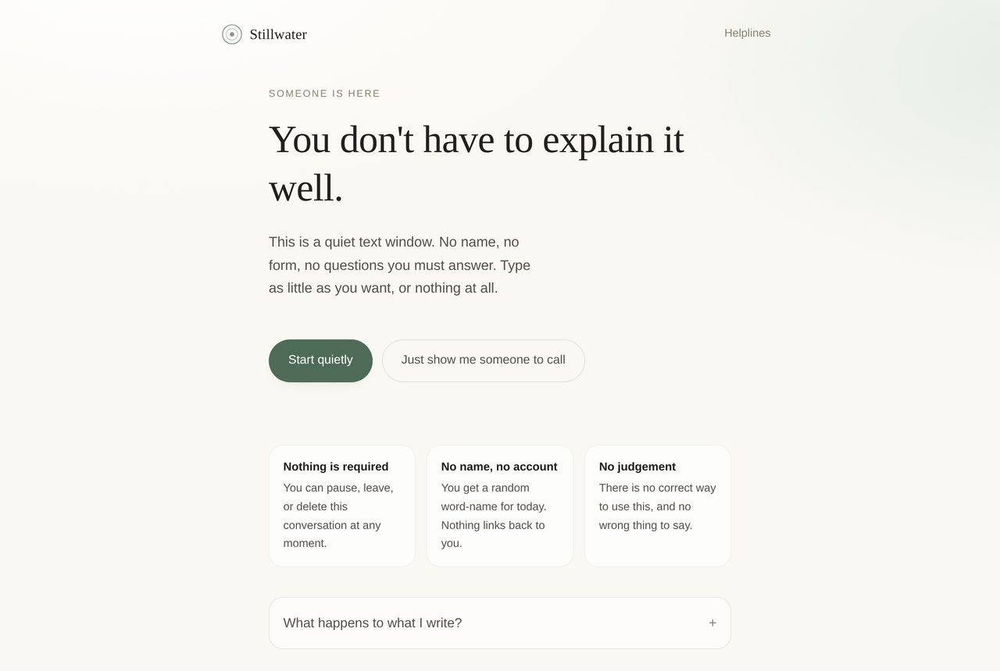
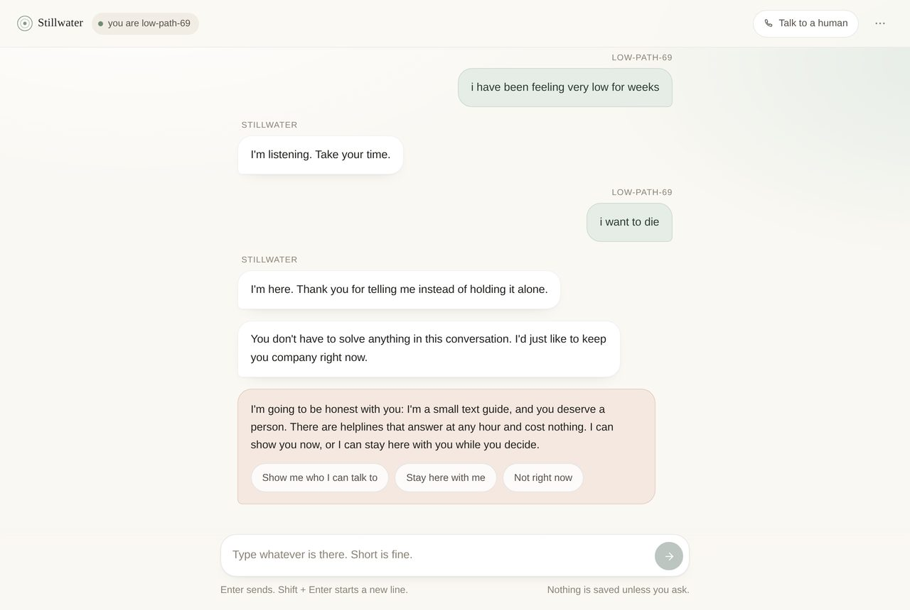
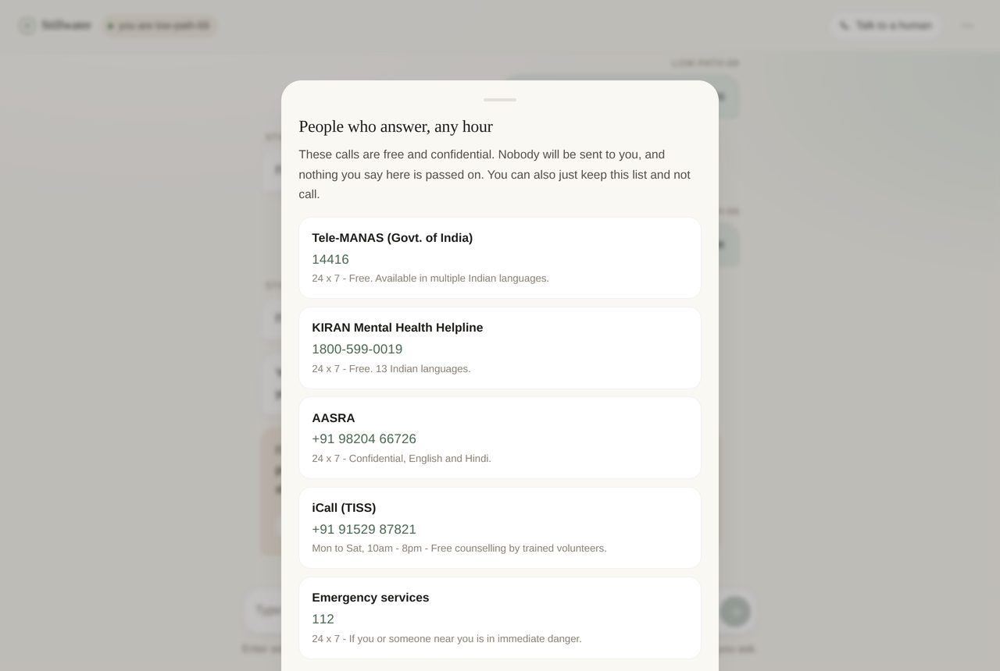
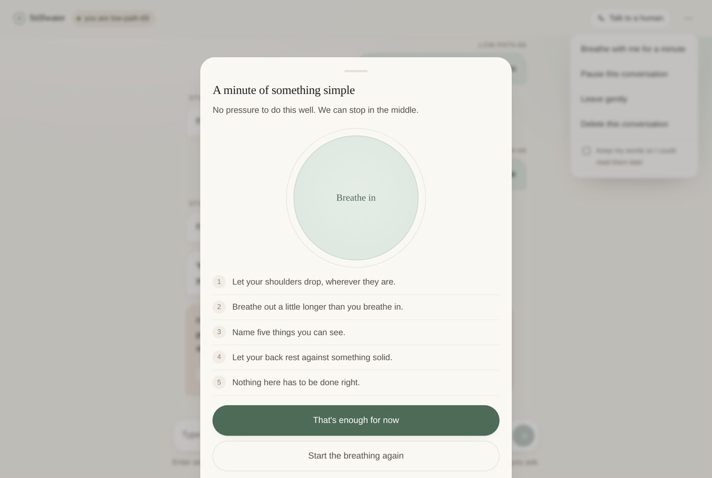
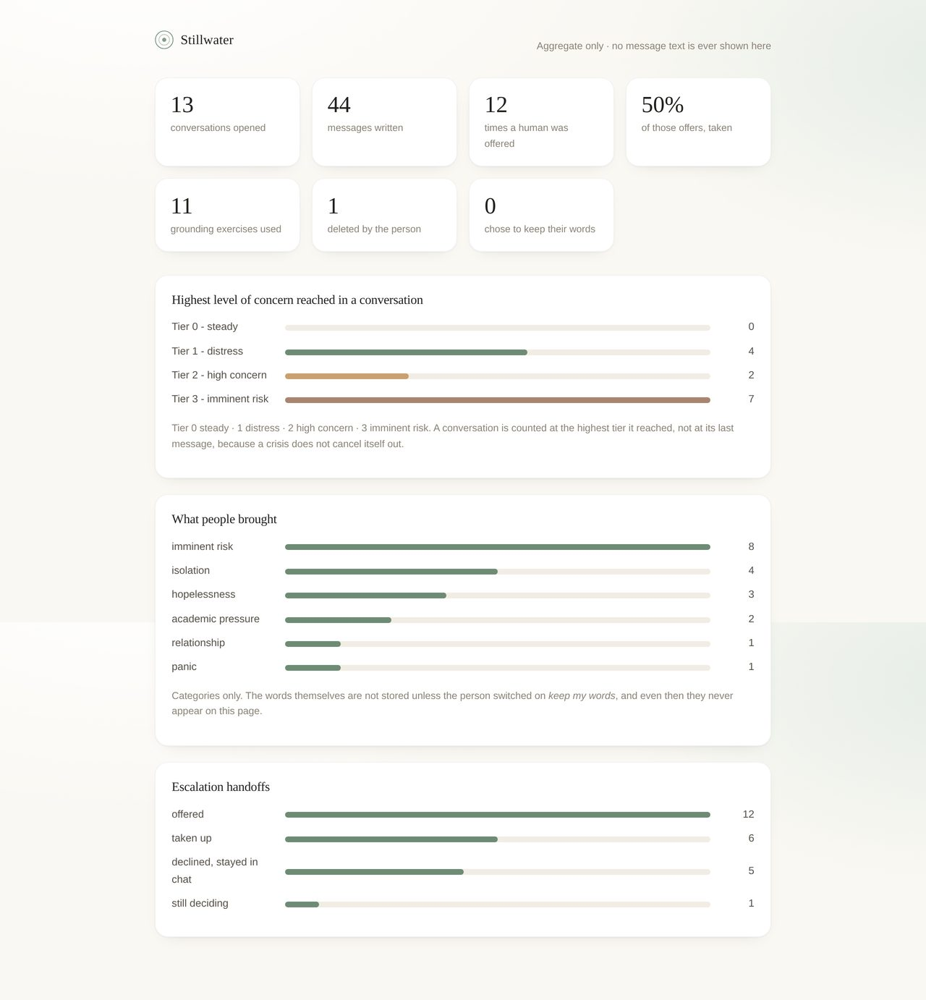
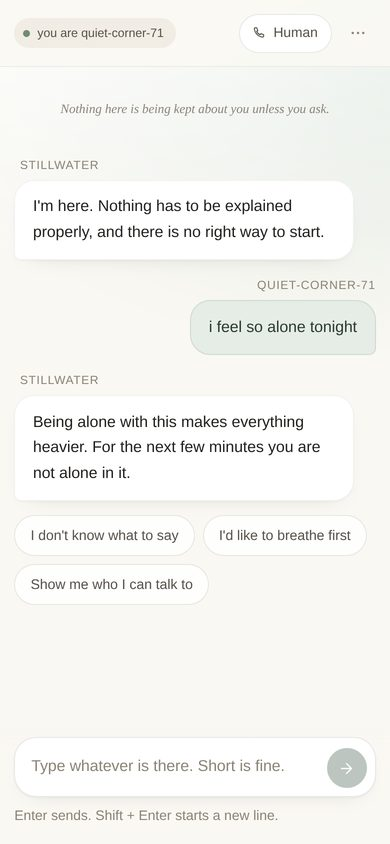
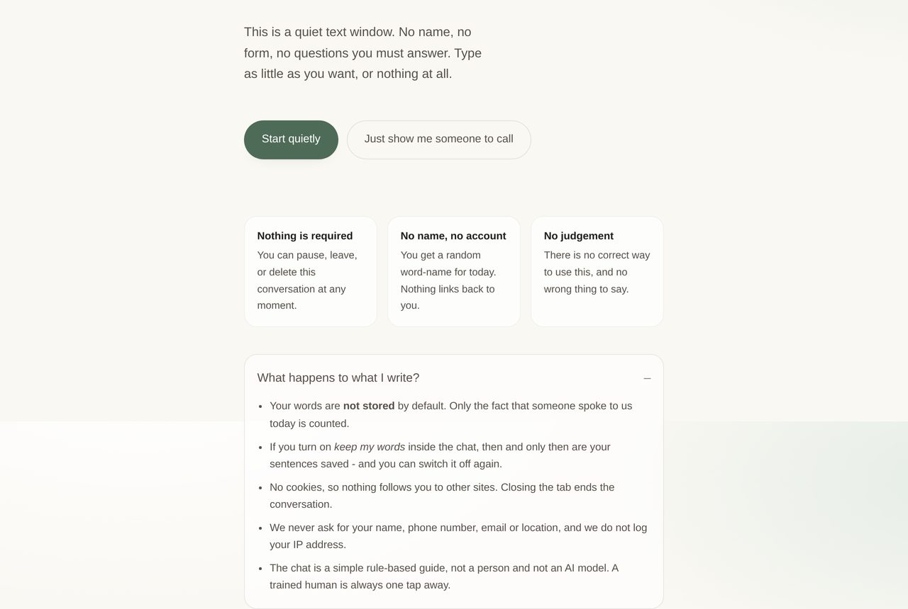

# Stillwater - a trauma-informed crisis helpline chat

> A quiet place to be heard.

A text-based support chat for people in emotional distress, built so that **the interface itself never
adds pressure, judgement or confusion** - the three things the problem statement asks about: **tone**,
**escalation paths**, **anonymity**.

Runs in **XAMPP** (PHP + MySQL, or zero-setup SQLite) and also as a **Node/Express** build that can be
deployed to a free host. Both read the same `rules.json`, and answer identically.



---

## The idea in one paragraph

Most support-chat projects spend their effort on the quality of the *answers*. This brief is about the
*window*: a person opens it at 2 a.m., types three words, and must be able to leave without having been
asked for a name, judged for a feeling, or left confused about what happens next. So every sentence the
interface can say is pre-written, tone-linted and finite; escalation is an **offer with an equal-weight
decline** rather than a redirect; and anonymity is enforced in the database schema, not in a promise.

## The three core challenges, and how they are answered

| Challenge | Naive answer | What Stillwater does |
|---|---|---|
| **Tone** | "Be empathetic" | 58 fixed sentences in `rules.json`, checked by `tools/tone-lint.php` for exclamation marks, "just", "calm down", "at least", "should", and any question in the opening line. The build fails if the tone rots. |
| **Escalation** | "If in crisis, call a helpline" | A 4-tier ladder with handrails **in both directions**: the offer appears once, decline is the same size as accept, "Talk to a human" is in the header from second one at every tier, and de-escalation is accepted instantly. |
| **Anonymity** | "We value your privacy" | No name, email, phone, cookie or IP column. `messages.body` is `NULL` unless the user switches on *keep my words*. Delete is a hard delete, and the alias is erased with it. |

Full reasoning: [`docs/02-trauma-informed-design.md`](docs/02-trauma-informed-design.md).

## Screens

| | |
|---|---|
|  |  |
| Chat: two holding sentences, then one gentle offer | The handoff - free, 24x7, one tap, no form |
|  |  |
| Grounding: breathing pacer + 5-4-3-2-1, opt-in | Observer view: aggregate counters only, never text |
|  |  |
| Mobile | Transparency, before anything is typed |

## What makes this different from a chatbot project

- **No language model.** Every reply is a finite, reviewable line. That is what makes "this interface
  never says anything pressuring" a *testable* claim instead of a hope.
- **A tone linter that fails the build.** Tone is a requirement, so it has a check.
- **Data minimisation in the schema.** `body TEXT NULL` - the sentence is not stored unless asked.
- **Multilingual distress lexicon.** Transliterated Hindi, Kannada and Tamil, plus some script, so
  *"nanna life waste aagide, saaybeku anstide"* is caught as imminent risk.
- **Negation guard.** "I **don't** want to die, I just want the pain to stop" is not scored as risk.
- **An escalation offer that is never repeated**, because repetition is pressure.
- **A real delete**, not a soft-delete flag.
- **Two backends, one rules file**, with a parity test proving they answer identically.
- **12 automated behaviour tests + 58 tone checks**, all runnable in one command.

## Run it in XAMPP (what the college submission uses)

1. Copy the `app-php` folder into `C:\xampp\htdocs\` and rename it `stillwater`
   (so you have `C:\xampp\htdocs\stillwater\index.php`).
2. Start **Apache** in the XAMPP control panel.
3. Open <http://localhost/stillwater/>.

That is all. The database file is created automatically in `app-php/storage/` on first load
(**no import step, no `phpMyAdmin` clicking**). It uses PDO + SQLite, which ships enabled in XAMPP.

**To show it in phpMyAdmin instead (recommended for the report):**

1. Open <http://localhost/phpmyadmin> → **New** → database name `stillwater` → **Create**.
2. **Import** → choose `app-php/database/schema-mysql.sql` → **Go**.
3. Edit `app-php/includes/config.php`, change `'driver' => 'sqlite'` to `'driver' => 'mysql'`.
4. Reload the app. Tables fill up as you chat; screenshots of `sessions` and `escalations` make a good
   report figure.
   *(Root user with a blank password is XAMPP's default; change it in the same file if yours differs.)*

**Observer dashboard:** <http://localhost/stillwater/observer.php> - passphrase `stillwater-demo`
(change `observer_key` in `includes/config.php` before submitting).

## Run it in VS Code (Node build)

```bash
cd app-node
npm install
npm start          # → http://localhost:3000
npm test           # 12 behaviour tests
```

Deployable as-is to Render / Railway / Fly (start command `npm start`, Node 18+). `app-node` stores to
`data/runtime.json`, so no native build tools are needed on Windows.

## Project structure

```
trauma-informed-crisis-chat/
├── app-php/                     # ← the XAMPP build (college submission)
│   ├── index.php                # landing: hero, promises, transparency, helplines
│   ├── chat.php                 # chat, pause, exit, delete, sheets
│   ├── observer.php             # evaluation dashboard
│   ├── api.php                  # one JSON endpoint: start/message/escalate/end/stats...
│   ├── includes/
│   │   ├── config.php           # driver, helplines, observer key
│   │   ├── db.php               # PDO + automatic schema creation
│   │   ├── engine.php           # lexicon → negation → tier → reply
│   │   └── partials.php         # shared head / wordmark / footer
│   ├── data/rules.json          # EVERY sentence + the distress lexicon
│   ├── assets/                  # style.css, chat.js, observer.js
│   ├── database/                # schema-mysql.sql, schema-sqlite.sql
│   └── tools/
│       ├── tone-lint.php        # fails on pressure / judgement / confusion
│       └── test-cases.php       # 12 behaviour tests
├── app-node/                    # ← the deployable build
│   ├── server.js                # Express, same API contract
│   ├── lib/engine.js            # port of engine.php
│   ├── public/                  # index, chat, observer
│   ├── data/rules.json          # same rules
│   └── test/engine.test.js      # same 12 promises
└── docs/                        # the report material
```

## Documentation

| File | What it covers |
|---|---|
| [`docs/01-problem-and-scope.md`](docs/01-problem-and-scope.md) | Who the user is, what is in and out of scope, success criteria, ethics |
| [`docs/02-trauma-informed-design.md`](docs/02-trauma-informed-design.md) | The 6 SAMHSA principles → the exact element implementing each |
| [`docs/03-tone-guide.md`](docs/03-tone-guide.md) | The 10 tone rules, the rewrite table, and the linter that enforces them |
| [`docs/04-escalation-ladder.md`](docs/04-escalation-ladder.md) | The 4 tiers, why an offer beats a redirect, de-escalation |
| [`docs/05-anonymity-policy.md`](docs/05-anonymity-policy.md) | What is collected, what is not, and the code that guarantees it |
| [`docs/06-test-cases.md`](docs/06-test-cases.md) | Test tables, parity results, persona walk-through, what was not tested |
| [`docs/07-schema-and-er.md`](docs/07-schema-and-er.md) | ER diagram and the six design decisions worth defending |
| [`docs/08-viva-questions.md`](docs/08-viva-questions.md) | Likely viva questions with answers that match the code |

## How a message flows

```mermaid
flowchart LR
    A[User types] --> B[api.php / POST - no cookie]
    B --> C[normalise<br/>lowercase, unify quotes]
    C --> D[match 20 lexicon categories<br/>+ negation window]
    D --> E[tier = highest hit<br/>0..3, sticky per session]
    E --> F[pick an unused reply<br/>from the bank in rules.json]
    F --> G[store category + tier<br/>body only if keep_words]
    G --> H[reply bubbles<br/>+ offer if tier >= 2, once]
    H --> I[chips: show help / stay / not now]
```



## Tests

```bash
php app-php/tools/test-cases.php     # 12 of 12 behaviour cases
php app-php/tools/tone-lint.php      # 58 strings, 0 failures (exit 0)
cd app-node && npm test              # same 12 promises, Node build
```

## Honest limitations

- The lexicon does not understand context: "my friend wants to die" is scored as the user's own risk.
  Over-triggering is the safer failure here, and it produces one gentle offer, not a label.
- There is no real human at the other end of the handoff. The project models escalation honestly
  instead of faking a call centre.
- Screen-reader behaviour is implemented (live region, skip link, focus rings) but has not been tested
  on a physical NVDA/VoiceOver pass.
- Single-user prototype: not tuned for concurrency.

## Disclaimer

An academic prototype. Not a clinical service, and not a replacement for a mental health professional.

If you or someone near you is in danger, call **112**.
In India: **Tele-MANAS 14416** · **KIRAN 1800-599-0019** (free, 24x7) · **AASRA +91 98204 66726** ·
**iCall +91 91529 87821**.

## License

MIT - see [LICENSE](LICENSE).
