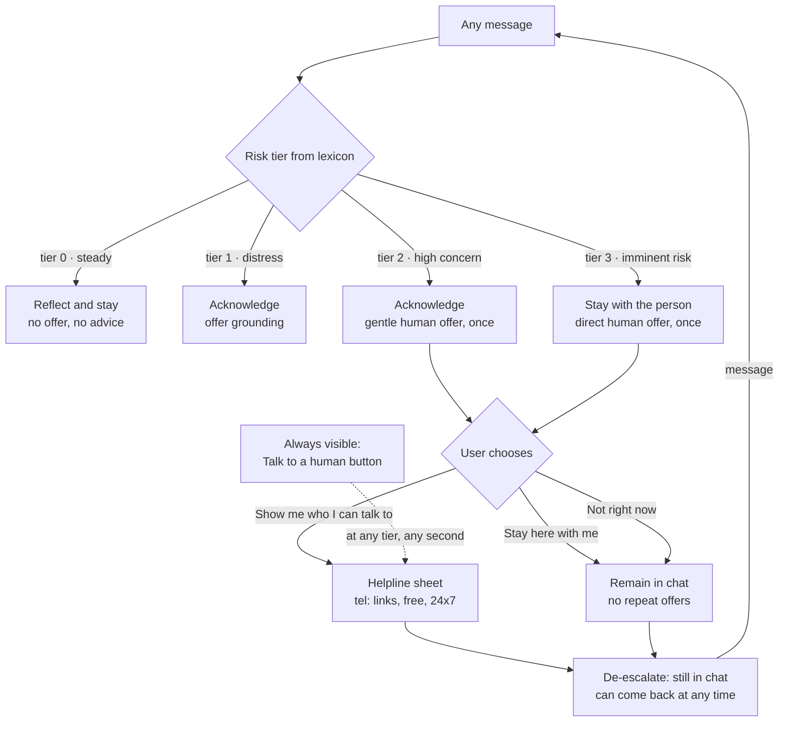

# 04 - Escalation paths

The second core challenge. The naive version of escalation is a redirect:
*"If you are in crisis, please call a helpline."* That sentence does three harmful things at once - it
abandons the person, it frames them as "too much", and it makes help conditional on doing admin work
(finding a number, calling a stranger) at the worst possible moment.

This project treats escalation as **a ladder with handrails in both directions**.

## The ladder

Note the dotted line. The header button **"Talk to a human"** is present from the first second of the
conversation at every tier, including tier 0. A person should never have to prove their distress to a
keyword detector before being allowed to see a phone number.

## The four tiers

| Tier | Name | Example input | Interface response | Escalation offer |
|---|---|---|---|---|
| 0 | steady | "okay", "thanks", "what is this" | Reflect, answer, stay | None (but the header button is there) |
| 1 | distress | "i am so alone", "my marks are bad" | Acknowledge, offer grounding exercise | Not yet - an offer here would feel like being handled |
| 2 | high concern | "i can't go on", "my father hits me" | Acknowledge, then a soft offer of a human | Yes, once |
| 3 | imminent risk | "i want to die", "saaybeku anstide" | Stay with them first (two bubbles), then a direct offer | Yes, once, immediately |

Tier is the **highest** tier reached in the session (`sessions.tier_max`), not the tier of the last
message. A crisis does not cancel itself out because the next sentence was "okay".

## Why an offer and not a redirect

| Redirect (common) | Offer (this project) |
|---|---|
| "Please contact a helpline." | "There are people trained for this, free, any hour. I can put their details on the screen, or we can stay here. Both are fine." |
| Ends the conversation | Continues it either way |
| The user must act or be at fault | The user cannot fail at this screen |
| No decline path | Decline is the same size as accept |
| Repeats if they stay | Offered once; never repeated |

On accepting: *"I've put them below. Nobody will call you, and nothing is shared unless you choose to
share it."* Several real services do call back or dispatch help; this prototype never claims to, and
the copy never implies it.

On declining: *"That's completely fine. I'm still here."* - and that is literally the end of it. No
second nudge, no repeated card. The header button stays available forever.

## De-escalation

A ladder that only goes up is not trauma-informed, it is a trap. Two mechanisms go down:

1. **Voluntary:** the user says *"i feel a bit better"* / *"calmer now"* - the engine accepts it and
   returns to tier 0 phrasing without comment. It does not say "are you sure?".
2. **Silent:** declining an offer records `accepted = 0` and does not raise anything again.

## What the ladder records (for the report)

`escalations` keeps one row per offer: tier, when it was shown, and `accepted` (1 / 0 / NULL while
undecided). This is what makes the claim "people mostly stay in the chat" measurable, instead of an
opinion. The observer dashboard shows offered / taken / declined / undecided.
