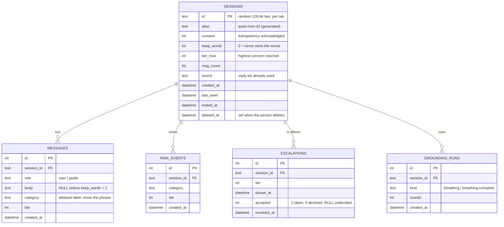

# 07 - Data model and ER diagram

Five tables, created automatically on first run (`includes/db.php`). The same schema is written out for
both drivers: `app-php/database/schema-sqlite.sql` and `app-php/database/schema-mysql.sql`.

## Design notes worth defending in the viva

1. **`messages.body` is nullable on purpose.** Nullability is the data-minimisation policy expressed in
   the schema. An examiner can see the anonymity rule in the DDL, not just in a paragraph of the report.
2. **`category` stores an abstract label, never the matched phrase.** Storing "the user typed 'saaybeku'"
   would be the same as storing the sentence. The lexicon match is used and discarded.
3. **`sessions.tier_max` is a maximum, not a current value.** A conversation that reached tier 3 is
   still a tier-3 conversation after the user calms down - otherwise the statistics would flatter the
   system by counting only final states.
4. **`sessions.deleted_at` is kept, but everything else is destroyed.** The flag exists so the observer
   dashboard can count "how many people exercised their right to delete", which is itself a design
   metric. It cannot be used to recover anything.
5. **No `users` table, no `user_id` anywhere.** Anonymity is structural, not a setting.
6. **`recent` is a small JSON array of reply ids** used only to avoid repeating the same sentence inside
   one conversation. It contains no user content.

## Where the rules live

`app-php/data/rules.json` (mirrored at `app-node/data/rules.json`) holds:

- `categories` - the distress lexicon: 20 categories, each with a tier and a term list in English plus
  transliterated Hindi / Kannada / Tamil;
- `negation_terms` and `negation_window` - so "i do **not** want to die" is not scored as risk;
- `replies` - every sentence the interface can say, in banks, with ids;
- `escalation` - the offer copy and the chips;
- `grounding` - the exercise text.

Because the rules are data, the tone can be linted, translated and reviewed by someone who does not
read PHP.
